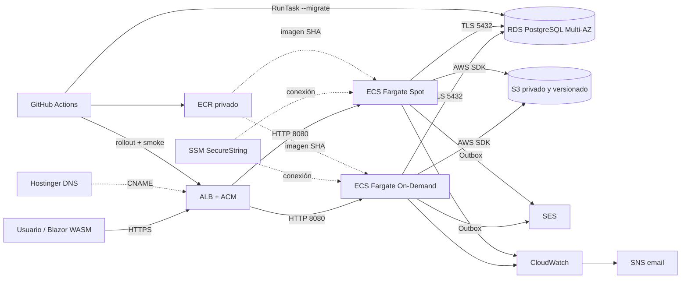

# Guarda.cat

Plataforma comunitaria en catalán para publicar artículos en Markdown, leer contenido y conversar mediante comentarios. Implementa el MVP propuesto para *Communly* y añade tags, likes, perfiles, avatares, una imagen por publicación y avisos por correo.

[](https://github.com/pgimeno/guarda.cat/actions/workflows/ci.yml)

## Estado

El proyecto cumple ampliamente el enunciado: aplicación funcional, Terraform, AWS, alta disponibilidad básica, backups, HTTPS, observabilidad, FinOps y despliegue automático desde `main`.

Validación final del 11/11/2026:

- compilación Release correcta: 0 errores y 0 advertencias;
- configuración Terraform formateada y válida;
- auditoría NuGet directa y transitiva sin vulnerabilidades conocidas;
- producción responde HTTP 200 en `/`, `/api/health/live` y `/api/health/ready`;
- ECS mantiene 2/2 tareas y dos targets sanos en `eu-west-1a` y `eu-west-1b`;
- RDS PostgreSQL está disponible, cifrado, no público, Multi-AZ y con backups de siete días;
- S3 está privado, cifrado con SSE-S3 y versionado;
- cinco alarmas CloudWatch están activas y enlazadas a una suscripción SNS confirmada;
- AWS Budgets mantiene un límite mensual de 60 USD.

La [ejecución automática #17, intento 2](https://github.com/pgimeno/guarda.cat/actions/runs/43074758050) acreditó la revisión final: commit `0460f9a9950e7b8106669e10b781054bcae866ef`, imagen ECR `sha256:39be181c726f83b7f7e8cd5179dbb18341057512170f72b56a0c1b1a8ef594dc`, migración correcta, revisiones ECS `5`, servicio estable y smoke tests HTTPS superados.

Dos controles formales siguen pendientes:

1. GitHub Actions utilizó el rol temporal `AWSReservedSSO_StudentLabAccess_eb79d21e536afb38`, que tiene `PowerUserAccess`; la identidad está acreditada mediante CloudTrail, pero no cumple mínimo privilegio.
2. La página pública de ramas declara `protectedByBranchProtections: false` para `main` y el repositorio no tiene rulesets.

Los roles de ejecución y aplicación de ECS sí están acotados por recurso y protegidos mediante `StudentBoundary`. El detalle técnico y la matriz de cumplimiento están en [docs/proyecto.md](docs/proyecto.md).

## Funcionalidad

- Lectura anónima paginada y ordenada por fecha.
- Detalle público de publicaciones y comentarios.
- Registro, login y sesión mediante ASP.NET Core Identity.
- Creación, edición y borrado de publicaciones propias en Markdown seguro.
- Comentarios, tags, filtro por tag y likes en publicaciones.
- Perfiles con nombre, bio y avatar.
- Una imagen por publicación, elegida al crear desde archivo JPEG/PNG o URL HTTP/HTTPS.
- Avisos por email mediante outbox transaccional y Amazon SES.

Quedan fuera: seguidores, feed personalizado, panel de administración, likes en comentarios y downvotes.

## Arquitectura



- Un único host ASP.NET Core sirve Blazor WebAssembly, Minimal APIs y `/media/*`.
- La VPC abarca dos AZ. ALB y ECS usan subredes públicas; RDS usa subredes aisladas.
- Las tareas tienen IP pública para evitar NAT Gateway, pero solo aceptan tráfico desde el Security Group del ALB.
- PostgreSQL conserva Identity, negocio, outbox, metadatos y claves compartidas de Data Protection.
- S3 nunca es público. Las imágenes locales pasan por la aplicación para permitir revocación inmediata.
- Una tarea Fargate On-Demand mantiene capacidad mínima; la segunda usa Spot para reducir coste.

Diagrama editable: [docs/architecture.excalidraw](docs/architecture.excalidraw).

## Decisión arquitectónica

Se eligió un monolito modular ASP.NET Core sobre ECS Fargate con RDS PostgreSQL:

- mantiene transacciones, relaciones e Identity en un almacén adecuado;
- evita administrar EC2 o un clúster Kubernetes;
- permite dos réplicas sin depender de disco o sesión local;
- usa un único artefacto Docker para web y migraciones;
- reduce componentes para el alcance académico.

Alternativas descartadas:

| Alternativa | Motivo |
| --- | --- |
| EC2 + Auto Scaling | Exige parches, AMI y administración del sistema operativo. |
| EKS | Añade control plane y operación innecesarios para un solo servicio. |
| Lambda + API Gateway | Complica conexiones SQL, workers y red. |
| DynamoDB | El modelo relacional, Identity y las transacciones favorecen PostgreSQL. |
| Cliente separado en S3/CloudFront | Añade otro artefacto y dificulta la retirada inmediata de medios. |
| Microservicios, Redis o bus | No resuelven requisitos del MVP y aumentan coste y superficie operativa. |

CloudFront y AWS Backup para S3 se excluyen conscientemente. S3 usa versionado con retención de versiones no actuales durante 30 días; es protección reducida, no un backup independiente.

## Estructura

```text
src/                    Client, Contracts y Server
tests/                  pruebas de integración
infra/                  Terraform de producción
.github/workflows/      CI y despliegue AWS
scripts/                validación Release, empaquetado y restauración local
docs/proyecto.md        resumen técnico y evidencias
docs/architecture.excalidraw
```

## Compilar y ejecutar

Requisitos:

- SDK fijado por `global.json` (.NET 10);
- Docker y Docker Compose;
- PowerShell 7 para los scripts.

Compilación:

```powershell
dotnet restore GuardaCat.slnx
dotnet build GuardaCat.slnx --configuration Release --no-restore
```

Desarrollo:

```powershell
Copy-Item .env.example .env
docker compose up -d postgres
dotnet tool restore
dotnet user-secrets set "ConnectionStrings:Postgres" "Host=localhost;Port=5433;Database=guardacat;Username=guardacat;Password=<contraseña>" --project src/GuardaCat.Server
dotnet ef database update --project src/GuardaCat.Server --startup-project src/GuardaCat.Server
dotnet run --project src/GuardaCat.Server --launch-profile https
```

Aplicación: [https://localhost:7125](https://localhost:7125).

Pruebas:

```powershell
$env:GUARDACAT_TEST_POSTGRES = "Host=127.0.0.1;Port=5433;Database=postgres;Username=guardacat;Password=<contraseña>"
dotnet test tests/GuardaCat.IntegrationTests --configuration Release
./scripts/verify-packaging.ps1
```

El usuario PostgreSQL de pruebas debe poder crear y borrar bases temporales. No se debe apuntar la suite a la base normal de la aplicación.

## Despliegue

Terraform define VPC, red, ALB, ACM, ECS, ECR, RDS, S3, SSM, SES, CloudWatch, SNS y Budgets. El bootstrap permitido crea únicamente el bucket remoto de estado.

Resumen:

1. Copiar `infra/backend.hcl.example` y `infra/terraform.tfvars.example` a archivos locales ignorados.
2. Inicializar Terraform y crear ACM/SES para publicar los CNAME requeridos en Hostinger.
3. Aplicar el stack inicialmente con `service_desired_count=0`.
4. Publicar una imagen inmutable en ECR y ejecutar la tarea ECS `--migrate`.
5. Elevar el servicio a dos tareas y validar HTTPS, targets, backups, S3, alarmas y presupuesto.
6. En operación normal, un push a `main` ejecuta CI y, si pasa, despliega automáticamente.

Comandos y variables: [infra/README.md](infra/README.md).

El pipeline restaura, audita NuGet, ejecuta Trivy, compila, prueba, verifica el publish, construye la imagen como usuario no root y valida Terraform. Las excepciones Trivy aceptadas quedan acotadas y justificadas en `.trivyignore.yaml`. En producción publica por SHA, migra, actualiza ECS, espera estabilidad y ejecuta smoke tests.

## Seguridad, disponibilidad y operación

- HTTPS mediante ACM; HTTP redirige.
- Cookies `HttpOnly`, `Secure`, `SameSite=Lax`; CSRF en mutaciones.
- Markdown sin HTML incrustado y salida sanitizada.
- RDS privado, cifrado y con TLS obligatorio.
- S3 privado, cifrado, versionado y restringido a `media/*`.
- Secretos fuera del código: SSM y GitHub Secrets.
- La salida de tareas ECS queda limitada a HTTPS y PostgreSQL hacia el SG de RDS.
- Contenedor no root, UID 1654.
- Logs ECS en CloudWatch durante 30 días.
- Circuit breaker de ECS con rollback del artefacto; las migraciones no se revierten automáticamente.
- RDS Multi-AZ y dos tareas en dos subredes. Spot puede reducir temporalmente la capacidad.

## Coste y retirada

Estimación orientativa:

- 56–60 USD/mes con ECS detenido;
- 75–82 USD/mes con dos tareas, antes de impuestos, tráfico y variaciones de precio.

Medidas: tarea pequeña, una réplica Spot, sin NAT Gateway ni Container Insights, SSM estándar y ciclos de vida en S3/ECR.

Para detener cómputo:

```powershell
Set-Location infra
terraform plan -var "service_desired_count=0" -out stop-service.tfplan
terraform apply stop-service.tfplan
```

La retirada completa es deliberadamente manual: exportar evidencias, decidir snapshot final de RDS, vaciar versiones S3 e imágenes ECR, desactivar protecciones mediante un plan revisado y solo entonces ejecutar `terraform destroy`. El bucket de estado queda fuera del stack.

## Límites aceptados

- SES permanece en sandbox.
- S3/SES funcionales y cookies entre réplicas se dieron por válidos sin nueva prueba funcional.
- No se ejecutaron una alarma SNS real, un PITR de RDS ni una restauración de versión S3.
- Sin CloudFront, backup independiente de S3, autoescalado ni prueba de carga.
- Una imagen se elige al crear un post; al editar solo se conserva o retira.
- Cada ejecución CI conserva TRX y reportes NuGet/Trivy; la evidencia de entrega debe corresponder al SHA final publicado.
- Antes de calificar la seguridad como cerrada: sustituir el rol PowerUser de GitHub por OIDC/rol mínimo y proteger `main` con PR y el check `build-test-image`.
