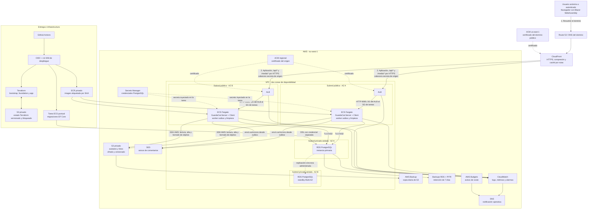

# Fase 0 - Arquitectura propuesta de Guarda.cat

Guarda.cat es una comunidad generalista en catalán, centrada en Cataluña y abierta a conversaciones sobre actualidad, cultura, ciencia, deportes, viajes y vida cotidiana desde una perspectiva global. La temática del producto no está limitada a contenidos técnicos.

## 0.1 Crear y aprobar el diagrama de arquitectura

Antes de generar la solución o provisionar recursos se debe revisar y aprobar este documento. Su objetivo es fijar los límites del sistema, los flujos de datos y las decisiones que condicionarán las fases posteriores.

La arquitectura es una propuesta pendiente de validación en la cuenta AWS real. En especial, deben confirmarse el dominio y la zona DNS, las restricciones de la cuenta del curso, las regiones y clases disponibles, el acceso de producción de SES y el presupuesto.

Revisión del 01/11/2026: [medios y outbox](media-and-outbox.md) implementa la fase 3. El criterio nuevo de retirar el acceso al eliminar una imagen sustituye la propuesta de caché larga S3/OAC: `/media/*` atraviesa el host con `no-store` y S3 permanece privado. El diagrama Mermaid siguiente refleja este ajuste; el archivo Excalidraw histórico aún debe sincronizarse antes de la entrega de infraestructura.

### Diagrama completo

El diagrama muestra flujos lógicos. `albA` y `albB` representan un único Application Load Balancer desplegado en dos subredes. Del mismo modo, RDS Multi-AZ expone un único endpoint; la instancia standby no atiende lecturas ordinarias.

### Arquitectura de la aplicación

- `GuardaCat.Client`: SPA Blazor WebAssembly con MudBlazor. Solo conoce DTO de `GuardaCat.Contracts` y consume la API del mismo origen.
- `GuardaCat.Server`: proceso ASP.NET Core que publica el cliente, expone Minimal APIs y contiene las funcionalidades de autenticación, posts, comentarios, tags, likes, perfiles e imágenes.
- Persistencia: un `DbContext` de EF Core con PostgreSQL para Identity, datos de negocio, claves de Data Protection, outbox de email y trabajos pendientes de borrado de medios.
- Adaptadores: S3 para archivos, SES para correo y almacenamiento local/captura de correo únicamente durante desarrollo.
- Procesos en segundo plano: cada réplica puede ejecutar los workers. Las filas se reclaman con lease y bloqueo en PostgreSQL para evitar trabajo simultáneo; el envío conserva semántica de al menos una vez.
- Artefacto: una sola imagen Docker multi-stage, ejecutada sin usuario root y escuchando en el puerto 8080. El modo web y el modo de migración usan el mismo artefacto.

### Flujos principales

1. **Lectura pública:** el navegador solicita contenido a CloudFront. Los recursos con hash usan caché larga; `/api/public/*` prevé una caché de 30 segundos. `/media/*`, rutas autenticadas y mutaciones no se cachean.
2. **Autenticación y escritura:** Blazor llama a la API del mismo dominio con cookie segura y token antiforgery. El servidor valida identidad, propiedad y límites antes de escribir en PostgreSQL o S3.
3. **Imágenes:** la API valida JPEG/PNG, registra compensación, sube el objeto con clave inmutable a S3 y activa sus metadatos en PostgreSQL. El host comprueba que los metadatos existen antes de servir el archivo; S3 sigue privado. La retirada de metadatos revoca nuevas lecturas, mientras el borrado físico se reintenta en segundo plano.
4. **Comentarios y email:** comentario y aviso se guardan en una transacción. Un worker reclama el aviso y llama a SES sin mantener abierta la transacción SQL.
5. **Borrado de medios:** la transacción SQL registra una tarea persistente. El worker elimina el objeto de forma idempotente; no se supone atomicidad entre PostgreSQL y S3.
6. **Despliegue:** GitHub Actions valida, asume un rol mediante OIDC, publica una imagen inmutable en ECR, ejecuta una única tarea de migración y actualiza ECS. El despliegue espera health checks y puede revertir la imagen, pero no revierte automáticamente el esquema.
7. **Recuperación:** RDS usa backups automáticos y restauración a punto en el tiempo. S3 usa versionado y AWS Backup. La restauración de SQL y objetos debe coordinarse porque no existe una instantánea transaccional conjunta.

### Decisiones y razonamiento

| Decisión | Motivo | Coste o limitación aceptada |
| --- | --- | --- |
| Monolito modular ASP.NET Core | El alcance cabe en una aplicación; reduce despliegues, contratos internos y operación. | Las funcionalidades comparten proceso y base de datos. Se separan por carpetas, no por microservicios. |
| Blazor WebAssembly alojado por ASP.NET Core | Mantiene toda la solución en .NET, evita circuitos persistentes de Blazor Server y permite cachear lecturas públicas. | Primera descarga mayor y sin compromiso de SEO en esta versión. |
| Un único artefacto Docker | Simplifica CI/CD, rollback y compatibilidad entre cliente y API. | El rollout debe conservar temporalmente los recursos WASM de la versión anterior. |
| ECS Fargate con dos tareas | Evita administrar EC2 y la complejidad de EKS, manteniendo contenedores y procesos de larga duración. | Coste continuo mayor que una solución que escala a cero. |
| Tareas en subredes públicas con IP pública | Evita NAT Gateways y endpoints privados en un proyecto académico. El SG solo permite entrada desde el ALB. | Es una simplificación de coste; las tareas no se describen como privadas. |
| RDS PostgreSQL Multi-AZ | Identity, relaciones, constraints, transacciones y outbox encajan en SQL. Multi-AZ cubre la caída de una AZ. | El standby no escala lecturas y un failover puede interrumpir temporalmente conexiones. |
| S3 para imágenes y PostgreSQL para metadatos | Los objetos no deben aumentar el tamaño ni los backups de la base de datos; S3 integra CDN, versionado y backup. | SQL y S3 no ofrecen una transacción común; se requieren compensación y conciliación. |
| CloudFront delante del ALB | Cachea recursos estáticos y JSON público y mantiene un único dominio; medios sin caché pasan por el host. | Hasta 30 segundos de consistencia eventual en JSON público; mayor tráfico/consulta al origen para imágenes a cambio de revocar URLs eliminadas. |
| Outbox PostgreSQL + `BackgroundService` | Evita perder avisos sin introducir SQS o Lambda y reutiliza las dos réplicas existentes. | Puede haber emails duplicados en un fallo concreto; no se promete exactamente una vez. |
| Terraform en tres stacks | Separa el estado, desbloquea ECR/OIDC antes del primer despliegue y permite destruir la aplicación sin perder el backend de estado. | Hay orden y comandos distintos para bootstrap, foundation y app. |
| GitHub Actions con OIDC | Elimina claves AWS estáticas en GitHub y limita la confianza al repositorio y entorno autorizados. | Requiere configurar primero el proveedor y los roles de foundation. |

### Seguridad y disponibilidad

- CloudFront es el único punto público previsto. El ALB acepta HTTPS desde la lista administrada de prefijos de CloudFront y exige una cabecera secreta de origen.
- Las tareas solo aceptan TCP 8080 desde el Security Group del ALB. RDS solo acepta TCP 5432 desde las tareas web y la tarea de migración.
- El tráfico navegador-CloudFront y CloudFront-ALB usa HTTPS; la conexión a PostgreSQL usa TLS con validación de certificado.
- S3 bloquea acceso público y deshabilita ACL. Solo el task role lee, escribe y borra en el prefijo autorizado; no conceder acceso directo de CloudFront a los medios mientras se exija revocación mediante metadatos.
- Los secretos no se incluyen en código, imágenes, `tfvars`, outputs públicos ni logs. Los roles de ejecución, aplicación, backup, migración y despliegue permanecen separados.
- ALB, ECS y RDS se distribuyen entre dos zonas de disponibilidad. Liveness comprueba el proceso y readiness comprueba PostgreSQL con timeout corto.
- CloudWatch centraliza logs con retención explícita. La alarma principal detecta menos de dos targets saludables y SNS notifica al responsable.
- Los recursos compatibles usan las etiquetas `Project`, `Environment` y `Owner`; AWS Budgets avisa de desviaciones, pero no detiene automáticamente el gasto.

### Alternativas descartadas para esta versión

- **Blazor Server:** viable, pero añade conexiones persistentes y estado de interfaz por visitante para un producto de lectura pública.
- **Cliente estático en S3 y API separada:** viable, pero implica dos artefactos y dos despliegues de aplicación. Puede reevaluarse si el tráfico estático lo justifica.
- **Lambda y API Gateway:** viable, pero complica conexiones SQL, ejecución de workers y red sin aportar una ventaja necesaria al alcance actual.
- **EC2 con Auto Scaling:** cumple los requisitos, pero obliga a mantener sistema operativo, parches e imágenes de máquina.
- **EKS:** añade control plane y operación de Kubernetes para una única aplicación.
- **DynamoDB:** el modelo relacional, Identity, las restricciones únicas y las transacciones hacen preferible PostgreSQL.
- **Redis, event bus y microservicios:** no resuelven un requisito del MVP y aumentarían coste y superficie operativa.

### Dependencias y riesgos que deben validarse

- Se necesita un dominio controlado y validación DNS para los certificados de CloudFront (`us-east-1`) y ALB (`eu-west-1`).
- SES en sandbox solo envía a destinatarios verificados; el acceso de producción depende de aprobación externa.
- Las clases de RDS, límites de Fargate, permisos, servicios y zonas disponibles deben comprobarse en la cuenta del curso antes de aplicar Terraform.
- El estado Terraform contiene datos sensibles aunque sus variables estén marcadas como sensibles; el bucket requiere acceso mínimo, cifrado, versionado y bloqueo.
- La estrategia de recursos estáticos debe probar un navegador abierto durante un rolling update para evitar incompatibilidades entre versiones de Blazor WASM.
- No se afirma una capacidad, latencia o disponibilidad cuantitativa sin medición. Tampoco se considera Multi-AZ un sustituto de los backups.

### Criterios de aceptación de la fase 0

- El diagrama identifica usuarios, CDN, orígenes, red, dos AZ, cómputo, datos, copias, entrega, observabilidad y notificaciones.
- Cada conexión expuesta indica protocolo o restricción de seguridad relevante.
- Los flujos de lectura, escritura, imágenes, email, despliegue y recuperación son coherentes con el enunciado.
- Las decisiones elegidas, alternativas descartadas, limitaciones y dependencias externas están documentadas.
- No se inicia la fase 1 hasta aprobar este documento y resolver cualquier cambio de arquitectura que afecte al modelo de datos, red o despliegue.
